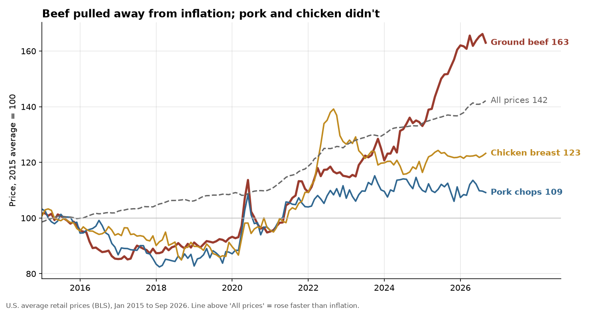
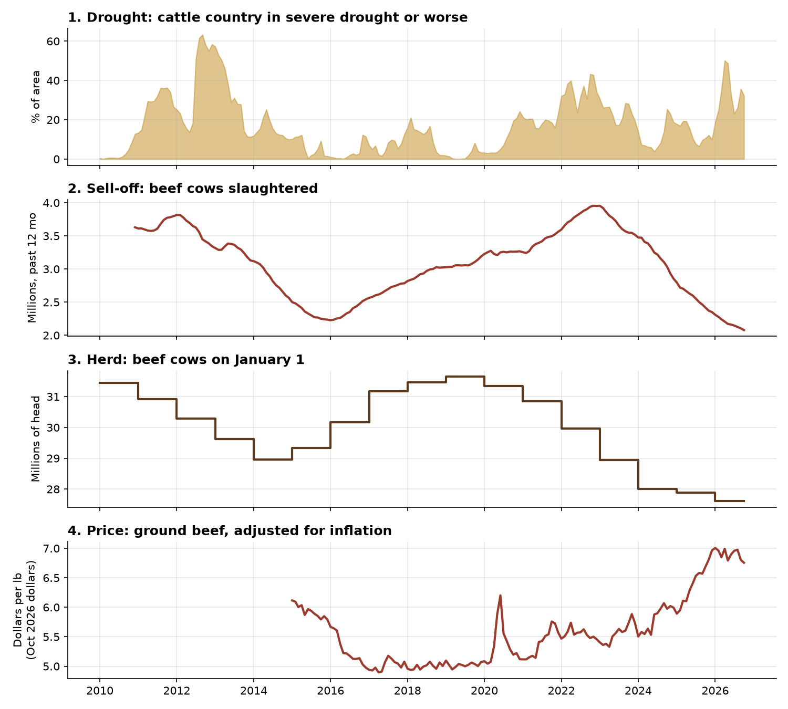

# Meat Price Explorer

[](https://github.com/schirko/meat-prices/actions/workflows/tests.yml)

**Project site:** [schirko.com/scott/meat-prices](https://schirko.com/scott/meat-prices/), with the summary, charts, every notebook and the project docs as readable pages.

**Why does meat cost so much now?** This project looks at U.S. retail prices for
beef, pork and chicken from 2015 to today. It shows where prices were before
2020, how they climbed, which events lined up with each jump, who gets each
retail dollar, and whether today's prices are justified by what is happening in
the supply chain.



## Key findings so far

*Data through September 2026. "Real" means adjusted for inflation, in September 2026 dollars.*

- **Beef is the outlier.** Ground beef is up **63%** since 2015, while prices in
  general rose **42%**. That leaves beef **15% more expensive in real terms**.
- **Pork and chicken got cheaper in real terms.** Pork chops are up only 9%
  (**23% cheaper** after inflation) and chicken breast 23% (**13% cheaper**).
  Groceries as a whole rose 33%, less than prices in general.
- **The cause is a cattle shortage, and drought started it.** Drought across
  cattle country pushed ranchers to sell off cows. The sell-off peaked in **2022**,
  when **13.2%** of the beef cow herd was slaughtered in one year. The herd shrank
  **13% from its 2019 peak**, and fewer cows means fewer calves and less beef
  for years afterward. The same chain played out after the 2011–2013 drought.
- **Ranchers are getting a bigger share of the money.** Their share of each
  retail beef dollar rose from **43% in 2019 to 54% in 2025**. That points to scarce
  cattle, not wider packer or grocery margins, as the main driver of the latest
  price rise. Milestone 4 will test this formally.



## How it was done

1. **Collected** free public data from four agencies: retail prices and
   inflation (BLS), price spreads (USDA ERS), cattle counts and slaughter
   (USDA NASS), and drought (U.S. Drought Monitor). See notebooks
   [01](notebooks/01_bls_retail_prices.ipynb) to [05](notebooks/05_grocery_categories.ipynb).
2. **Cleaned and combined** everything into one monthly table (Jan 2010 to the
   latest month, 56 columns). Every fix is documented, including problems found
   in the source files ([06](notebooks/06_clean_and_combine.ipynb)).
3. **Explored** the patterns behind the findings above
   ([07](notebooks/07_explore.ipynb)) and lined them up with a dated event list
   ([08](notebooks/08_events.ipynb)).
4. **Automated** the pipeline. One command re-downloads, rebuilds and checks the
   data, and 23 automated tests run on every push (the badge at the top).

**Limits.** These are national averages; local prices differ. BLS prices are
averages across stores, not a fixed basket. October 2025 is filled in because the
government shutdown stopped data collection that month. The findings so far show
patterns, and the statistical tests come in Milestone 4.

**Read more:** [plan and progress](docs/MILESTONES.md) ·
[every decision and why](docs/DECISIONS.md) ·
[data sources](docs/DATA_SOURCES.md) ·
[column dictionary](docs/DATA_DICTIONARY.md)

**Events:** 16 dated, sourced events (plant closures, drought, trade, disease, and
three popular claims) are marked on the price charts in
[notebook 08](notebooks/08_events.ipynb), and tested in
[notebook 11](notebooks/11_event_tests.ipynb). Notebook 11 compares the price after each
event with a forecast of where it was heading, then checks whether the gap is bigger than
in ordinary months. The 2020 COVID closures clearly shifted all three meats (+11% to +17%),
and chicken's 2022 spike was real. None of the popular claims holds up. Apart from COVID,
no sudden event clearly moved beef, so beef's rise points to the shrinking herd instead.

**Still to come:** testing the drought → herd → price chain directly, a final
verdict on whether today's prices are justified, and an interactive app.

---

## Questions this project answers

1. **Where were prices in 2015, and where are they now?** Per-pound retail prices
   for each meat, in dollars at the time and adjusted for inflation.
2. **What happened along the way?** A dated timeline of events (plant shutdowns,
   cyberattack, drought, import suspensions, disease) laid over the price history.
3. **Did those events actually move prices?** Statistical tests for whether
   prices shifted at each event, rather than just eyeballing a chart.
4. **Who got the extra money?** How each retail dollar splits between the
   rancher, the meatpacker and the grocery store, and how that split changed.
5. **Are today's prices still justified?** A plain-language verdict based on
   supply (herd size), inflation and margins.

## Data sources (all free, all public)

| Data | Source | Used for |
|---|---|---|
| Average retail prices per pound | U.S. Bureau of Labor Statistics (BLS) | The main price history |
| Consumer Price Index (CPI) | BLS | Adjusting for inflation |
| Meat price spreads (farm, wholesale, retail) | USDA Economic Research Service (ERS) | Who gets each dollar |
| Cattle inventory | USDA National Agricultural Statistics Service (NASS) | Supply side |
| Event timeline | Curated from news and USDA reports, with citations | Annotating charts, testing events |

**Key terms.** The price spreads follow one pound of meat through three stages:
the **farm** (what the rancher or hog farmer is paid), **wholesale** (what the
meatpacker gets) and **retail** (what shoppers pay). The gaps between them are
the spreads, and each stage's share of the retail price shows who gets each
dollar. Chicken has only the wholesale and retail stages.

**Who are these agencies?** BLS (Bureau of Labor Statistics) is part of the
Department of Labor and measures prices and inflation. ERS (Economic Research
Service) and NASS (National Agricultural Statistics Service) are part of the U.S.
Department of Agriculture: ERS is its research agency, and NASS runs its farm
surveys, including cattle counts.

Details on each agency and source, including how each data set was downloaded,
are in [docs/DATA_SOURCES.md](docs/DATA_SOURCES.md). Everything is combined into
one monthly table, `data/processed/master_monthly.csv`, described column by
column in [docs/DATA_DICTIONARY.md](docs/DATA_DICTIONARY.md).

## Project layout

```
meat-prices/
├── .github/workflows/   Runs the tests on every push (GitHub Actions)
├── app/                 Streamlit app (Milestone 5)
├── data/
│   ├── raw/             Data exactly as downloaded (not committed to git)
│   └── processed/       Cleaned data the app reads, plus REFRESH_REPORT.md
├── deploy/              Monthly refresh script for the server
├── docs/
│   ├── MILESTONES.md    The plan, progress and what each item involves
│   ├── DECISIONS.md     Every significant decision and why we made it
│   ├── DATA_SOURCES.md  Where each data set comes from and how to get it
│   └── DATA_DICTIONARY.md  Every column in the master table (generated)
├── notebooks/           Numbered Jupyter notebooks, one per analysis step
├── src/                 The data pipeline: download, build, check, publish
├── tests/               Data and pipeline tests (pytest)
├── .env.example         Template for API keys (copy to .env)
├── requirements.txt     Python packages (full development setup)
└── requirements-test.txt  Just what the pipeline and tests need
```

## How the notebooks are written

Every notebook follows the same pattern so a reader can follow along without
running the code:

- **What we're looking for:** the question this step answers
- **Code**, then **its result**
- **How to read it:** what the chart or table shows
- **What it means:** the plain-language finding
- **What's next and why:** how this step leads to the next one

## Setup

```bash
# 1. Activate the virtual environment (Windows)
.venv\Scripts\activate

# 2. Install packages
pip install -r requirements.txt

# 3. Add API keys
copy .env.example .env
# then edit .env and paste in your keys
```

## Refreshing and testing the data

Everything in `data/processed/` can be rebuilt from the official sources with one
command. New data only replaces the current files if every data check passes, and
each run writes `data/processed/REFRESH_REPORT.md` explaining what changed.

```bash
python -m src.refresh                      # download everything, rebuild, check, publish
python -m src.refresh --offline            # rebuild from the saved raw files (no downloads)
python -m src.refresh --offline --dry-run  # build and check only; change nothing
pytest                                     # run the data and pipeline tests
python -m src.readme_charts                # redraw the README charts and print its numbers
python -m src.build_site                   # rebuild the project site into SITE_DIR (see .env.example)
```

The tests check, among other things, that there is one row per month with no
unexpected gaps, that values are in sensible ranges, that the farm, packer and
store shares add up to 100%, and that every column is documented. They also
recreate the data problems found during development (thousands commas in USDA
files, a mislabeled USDA column, a month missing during the 2025 government
shutdown), so those can't come back unnoticed. GitHub Actions runs the tests on
every push. `deploy/monthly_refresh.sh` can run the refresh monthly on a server.

## Author

Scott Schirkofsky. Built as a data science portfolio project.
